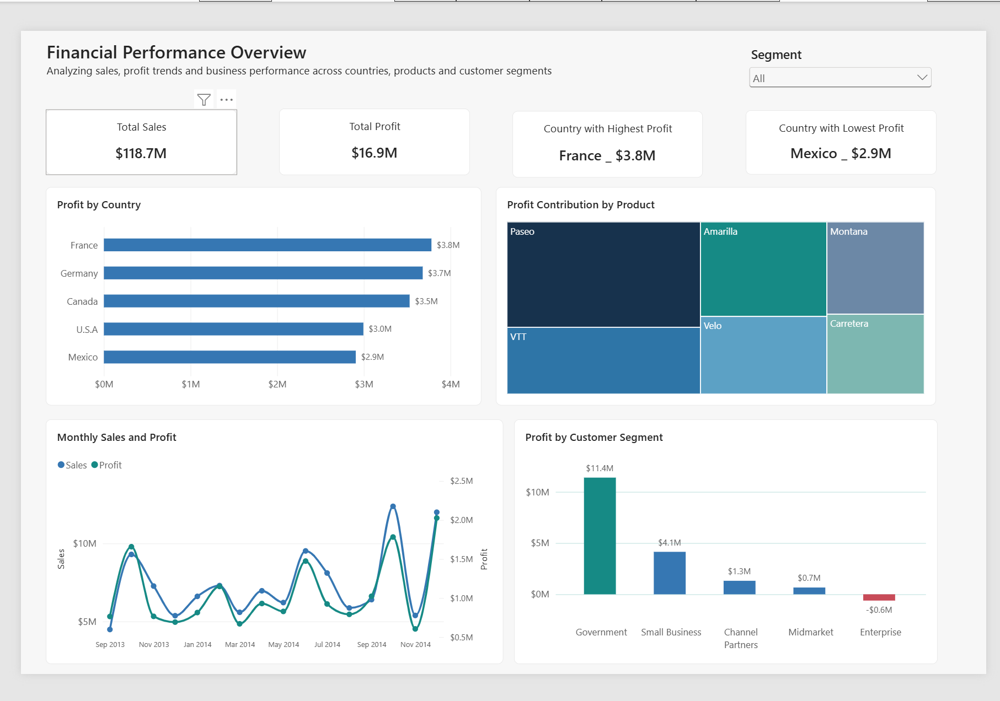

# Financial Performance Analysis | Power BI

**An interactive, single-page Power BI report exploring sales, profit trends, and performance across countries, products, and customer segments.**

> **Portfolio project:** Built for learning and demonstration using Microsoft's Financial Sample dataset. The dataset is fictional/sample data; findings do not describe a real company. 

## Dashboard preview

*If the preview does not appear, upload `FPA_dashboard_preview.png` to the same folder as this README.*

## Business questions

1. How much sales revenue and profit does the business generate?
2. Which countries contribute the most and least profit?
3. Which products contribute most to overall profit?
4. How do sales and profit change over time?
5. Which customer segments are the most profitable?

## Key findings

| Area | Finding |
| --- | --- |
| Overall performance | Approximately **$118.7M in sales** and **$16.9M in profit**. |
| Country profitability | **France** led at approximately **$3.8M**, while **Mexico** contributed approximately **$2.9M** (still profitable). |
| Product profitability | **Paseo** contributed approximately **$4.80M**, compared with approximately **$1.83M** for **Carretera**. |
| Monthly trend | **December 2014** recorded the highest observed monthly profit, approximately **$2.03M**. |
| Customer segments | **Government** contributed approximately **$11.4M**, while **Enterprise** recorded a loss of approximately **$0.6M**. |

*Figures are rounded for readability and reflect the unfiltered report; selecting slicers can change them.*

## Business interpretation and recommendations

- **Investigate Enterprise's losses.** Review its product mix, discounts, sales, and costs before making decisions about the segment.
- **Understand concentration in Government.** Explore why Government is the largest profit contributor and whether other segments offer opportunities.
- **Compare products carefully.** Paseo's higher total profit does not necessarily mean it has the highest profit margin; analyse revenue and cost alongside profit before recommending changes.

These are areas for further investigation, **not proven causes** of performance differences.

## Power BI techniques demonstrated

- KPI cards for headline metrics
- Ranked horizontal bar and column charts
- Treemap with DAX-based ranking tooltip
- Time-series line chart with a secondary Y-axis
- Interactive slicers and cross-filtering
- DAX measures for dynamic highest- and lowest-profit countries
- Conditional formatting for negative profit values
- Consistent chart titles, colour palette, and visual hierarchy

## Files in this repository

| File | Purpose |
| --- | --- |
| [`Financial_Performance_Analysis.pbix`](Financial_Performance_Analysis.pbix) | Editable Power BI Desktop report. |
| [`FPA_dashboard_preview.png`](FPA_dashboard_preview.png) | Static screenshot of the finished dashboard. |
| `README.md` | Project overview, findings, and instructions. |

## How to view the project

**Preview:** View the dashboard image above on GitHub. This is a static image, not an interactive report.

**Interactive report:** Download `Financial_Performance_Analysis.pbix` and open it in [Power BI Desktop](https://www.microsoft.com/en-us/power-platform/products/power-bi/desktop). Use the Segment slicer and select chart elements to explore how the metrics change. Power BI Desktop may ask you to confirm security prompts when opening a file obtained online.

## Data source and credit

Dataset: **Microsoft Financial Sample**, available from [Microsoft Learn](https://learn.microsoft.com/en-us/power-bi/create-reports/sample-financial-download).

This is an educational project using public sample data. It is not affiliated with or endorsed by Microsoft, and it is not a real client engagement.
